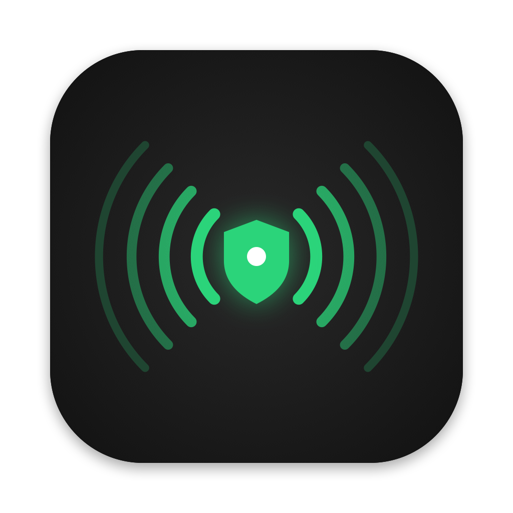

# AWDL Guard

Holds Apple Wireless Direct Link (AWDL) down on Macs when it hurts Wi-Fi latency, and
lets an MDM (Mosyle, Jamf, Kandji, Intune, …) decide when, per device group.

AWDL powers AirDrop, AirPlay peer-to-peer, Sidecar, Universal Control and other
Continuity features. To do that the Wi-Fi radio periodically leaves your access
point's channel to listen on the AWDL channels (6, 44, 149). While it is away,
traffic waits: you get latency spikes, choppy Zoom/Meet calls and sluggish browsing.
macOS has no switch for this, and `sudo ifconfig awdl0 down` no longer sticks because
the system brings the interface straight back up.

In a [quick test](docs/benchmark.md) on an office network, holding AWDL down took p95 latency
to the gateway from about 80 ms to 5.5 ms, and replies over 30 ms from 84-143 per minute to
none.

Built on the core of [AWDLControl](https://github.com/james-howard/AWDLControl) by
James Howard (MIT), which keeps `awdl0` down by watching routing-socket events. This
project adds an always-on daemon, MDM-managed configuration, call detection and
installer packaging.

## How it works

| Component | Runs as | Job |
|---|---|---|
| `awdl-guardd` | root, LaunchDaemon | Reads policy, decides, holds `awdl0` down or hands it back to macOS. Always restores AWDL when stopped. |
| `AWDL Guard.app` | each user, LaunchAgent | Reports frontmost/running apps and microphone use to the daemon; optional menu bar icon with status and temporary allow. |
| `awdl-guardctl` | anyone | CLI: status (also `--json`), mode, temporary allow, reload. |

The daemon and agent talk over XPC. Release builds only accept clients signed by the
same Developer ID team. All policy is enforced in the daemon, so a client can never do
more than the configuration permits. Nothing is sent off the Mac.

### Modes

- `auto` (default): AWDL is held down only while a trigger is active:
  - **microphone in use** (Zoom, Teams, FaceTime, Google Meet in any browser);
  - **game in the foreground** (same signals macOS uses for Game Mode);
  - **listed apps** (`TriggerApps`), either while running or only when frontmost.
  When the last trigger ends, AWDL comes back after `ReenableDelaySeconds`.
- `block`: AWDL is always held down (best latency; no AirDrop/AirPlay/Sidecar).
- `allow`: stock macOS behaviour; AWDL Guard stays out of the way.

The 0.1.0 names `off` (= `block`) and `on` (= `allow`) are still accepted.

Users can switch mode from the menu bar (*Mode*) or with `awdl-guardctl mode <auto|block|allow|default>`,
no admin rights needed. The choice survives restarts; `default` goes back to the configured
mode. `AllowUserModeChange` controls this: when it is not set, users may change the mode
unless a profile enforces `Mode`.

### Schedule

`Schedule` sets time windows with a fixed mode, for example block AWDL during office hours:

```xml
<key>Schedule</key>
<array>
  <dict>
    <key>Days</key>  <array><string>mon</string><string>tue</string><string>wed</string><string>thu</string><string>fri</string></array>
    <key>Start</key> <string>09:00</string>
    <key>End</key>   <string>18:00</string>
    <key>Mode</key>  <string>block</string>
  </dict>
</array>
```

- Inside a window its mode wins over `Mode` and the user's choice; outside, those apply as usual.
- `Days` is optional (default: every day). Times use the Mac's local time zone; `End` may be `24:00`.
- A window whose end is not after its start runs past midnight (`22:00`–`06:00`) and belongs
  to the day it starts on. If windows overlap, the first one listed wins.
- Exempt apps and the temporary allow still work inside a window.
- Invalid windows are ignored; `awdl-guardctl settings` shows what was understood.

### Emergency: give AWDL back everywhere

Push a profile with `Mode` = `allow` and no `Schedule`: Macs apply it within 30 seconds.
For Macs that must not wait for a profile, run
`launchctl bootout system/io.github.moragabriele.awdlguard.daemon` as root (e.g. a Mosyle
custom command): the daemon restores AWDL on exit and stays stopped until the next restart.

### Temporary allow and notifications

When AWDL is held down, users can allow it for a while from the menu bar (*Allow AirDrop/AirPlay
for → 5 minutes, 15 minutes, …*), up to `OverrideMaxMinutes`. Picking again restarts the time
from now. One minute before it ends a notification offers *Extend*.

Notifications need the user's permission, which macOS asks for the first time. The profile's
`com.apple.notificationsettings` payload grants it in advance; remove that payload to let users
decide.

### Exclusions

While an exempt app is running, AWDL stays available in both `auto` and `block` modes
(useful for apps used with Sidecar, Universal Control or AirPlay to a meeting-room TV,
even during a call). Administrators set `ExemptApps`. With `AllowUserExemptions`, users
can also add their own from the menu bar (*Exclusions → Add <app>* / *Choose App…*).
Users' lists are stored in their own preferences and only honoured while the policy
allows it.

With `OnlyOnWiFi` (default), AWDL is left alone when the Mac is on wired Ethernet.
VPNs are handled: what counts is the physical link, not the tunnel.

## Configuration

Preferences domain: `io.github.moragabriele.awdlguard`

| Key | Type | Default | Notes |
|---|---|---|---|
| `Mode` | string | `auto` | `auto`, `block`, `allow` |
| `AllowUserModeChange` | bool | see notes | not set: users may change the mode unless a profile sets `Mode` |
| `TriggerOnMicrophone` | bool | `true` | |
| `TriggerOnGames` | bool | `true` | |
| `TriggerApps` | array of strings | `[]` | bundle IDs, e.g. `us.zoom.xos` |
| `TriggerAppsMatch` | string | `running` | `running` or `frontmost` |
| `ExemptApps` | array of strings | `[]` | bundle IDs that keep AWDL available while running |
| `AllowUserExemptions` | bool | `false` | users can add their own exempt apps |
| `OnlyOnWiFi` | bool | `true` | |
| `ReenableDelaySeconds` | int | `30` | 0–3600 |
| `AllowUserOverride` | bool | `true` | user can allow AWDL temporarily (AirDrop) |
| `OverrideMaxMinutes` | int | `15` | 1–1440; the menu offers 5, 15, 60, 240 min below it, then the limit |
| `ShowMenuBarIcon` | bool | `true` | |
| `AllowUserQuit` | bool | `true` | hide Quit in the menu |
| `NotifyOnOverrideEnd` | bool | `true` | 1 minute before a temporary allow ends (with *Extend*) and when it ended |
| `NotifyOnSchedule` | bool | `true` | when a schedule window starts or ends |
| `NotifyOnAWDLChange` | bool | `false` | every time AWDL is held down or allowed again |
| `Schedule` | array of dicts | `[]` | `Days`, `Start`, `End`, `Mode`; see [Schedule](#schedule) |

Precedence: MDM profile > `/Library/Preferences` > defaults. Changes are picked up
within 30 seconds, or immediately with `awdl-guardctl reload`.

Without an MDM:

```bash
sudo defaults write /Library/Preferences/io.github.moragabriele.awdlguard Mode -string block
awdl-guardctl reload
```

## Deploying with an MDM

1. **Package**: upload `AWDLGuard-<version>.pkg` from the
   [releases](https://github.com/moragabriele/awdl-guard/releases) (signed and notarized).
2. **Profile**: deploy `profiles/AWDLGuard.mobileconfig` as a custom profile. It is set up for
   the official releases (Team ID `9WCXJSYTFT`); if you sign your own builds, put your Team ID
   in its `TeamIdentifier` rule. It carries the settings and pre-approves background items and
   notifications, so users see no "Background Items Added" notification and cannot turn the daemon off.
   For granular control, make one copy per device group (for example `Mode=block` for a team
   that never uses AirDrop and `Mode=auto` for everyone else). Give each copy its own
   `PayloadIdentifier` and `PayloadUUID`s, and scope only one per Mac.
   - **Jamf Pro only (optional)**: instead of editing XML, upload `profiles/jamf-schema.json`
     under *Application & Custom Settings → External Applications → Custom Schema* to get a
     form for the settings. Background items still need the `com.apple.servicemanagement`
     payload (Jamf: *Managed Login Items*).
3. **Inventory** (optional): `scripts/mdm-status.sh` prints one line per Mac
   (`held-down mode=auto version=0.1.0`) for custom attributes / extension attributes.
4. **Uninstall**: run
   `/Library/Application Support/AWDL Guard/uninstall.sh` as root, then remove the
   profiles.

## Building

Requires macOS 13+ to run and the Xcode Command Line Tools (Swift 5.10+) to build.

```bash
make build      # debug build
make test       # policy unit tests
make pkg        # universal .pkg in dist/ (ad-hoc signed: local testing only)
```

Release build (Developer ID certificates in your keychain, notary credentials stored once
with `xcrun notarytool store-credentials`):

```bash
APP_IDENTITY="Developer ID Application: <Name> (<TEAMID>)" \
PKG_IDENTITY="Developer ID Installer: <Name> (<TEAMID>)" \
NOTARY_PROFILE=<profile-name> \
./packaging/build.sh
```

Ad-hoc builds accept any local XPC client and log a warning; use them only for testing.

## Measuring the difference

```bash
./scripts/latency-bench.sh 120           # pings the default gateway for 2 minutes
```

Run it with AWDL allowed and again with it held down, doing the same thing on the Mac
each time. Each run appends a row (p50/p95/p99, jitter, spikes) to `latency-results.csv`.
See [docs/benchmark.md](docs/benchmark.md) for an example run and how to read it.

## Network-side mitigation

Placing the access point's 5 GHz primary channel on 44 (or 149 where permitted) reduces
how far the radio has to hop, because those are AWDL channels. It helps, but does not
remove the off-channel time.

## Trade-offs

While AWDL is held down, these do not work: AirDrop, AirPlay to nearby devices without
shared Wi-Fi, Sidecar, Universal Control, iPhone Mirroring, wireless Continuity Camera
and Apple Watch unlock. Use `auto` mode or the temporary allow when you need them.

## Logs

```bash
log stream --predicate 'subsystem == "io.github.moragabriele.awdlguard"'
```

## License

MIT. See [LICENSE](LICENSE). Contains code from AWDLControl © James Howard.
